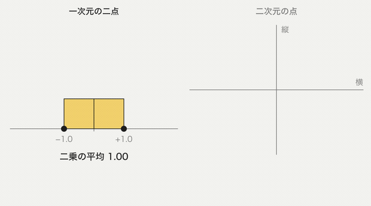
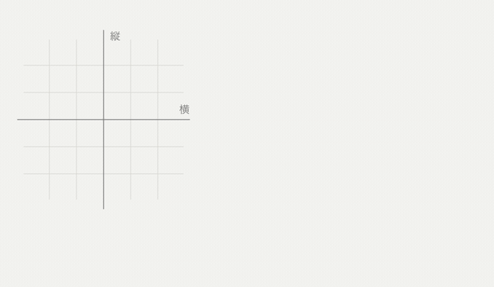
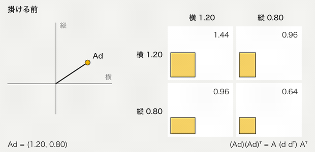
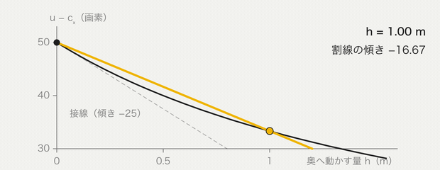
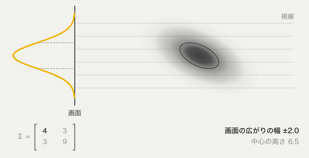

# 第4章 tiny3d.py：三次元の粒を投影して描画する

第4章の「投影」「重み」「合成」の三つの段階を、Pythonの標準ライブラリだけで書いたコードです。

```sh
python3 tiny3d.py
```

実行すると `splats3d.ppm` ができます。繰り返し試しやすいように、`open` には `wb`（同じ名前のファイルを上書きするモード）を渡しています。

## 関数と本文の式

| 関数 | 本文の式 |
| --- | --- |
| `rotation` | クォータニオン (w, x, y, z) を回転行列 $R$ にする |
| `covariance` | $\Sigma = R S S^\top R^\top$（第2章） |
| `project` | 中心を画素へ投影し、ヤコビアン $J$ で画面上の共分散 $J \Sigma J^\top$ を求める |
| `weight` | 重み $g$。逆行列は作らず、$d^\top \Sigma^{-1} d$ を $(c\,dx^2 - 2b\,dx\,dy + a\,dy^2)/(ac - b^2)$ に展開している |
| `render` | 粒を奥行きの順に一度だけ並べ、[tiny.py](../ch04_tiny/) の `pixel` と同じ手順で重ねる |

ファイルの中の `assert` は本文の数値を確かめています。横の標準偏差が0.01mの粒は、奥行き2mで5画素、1mで10画素になります。スケールを (0.1, 0.1, 0.6)、中心を (0.6, 0, 2) にした粒は、画面上の標準偏差が約103画素になります。

## 省いているもの

世界座標からカメラ座標への変換、球面調和関数による色、画面上の共分散の対角に0.3を足す処理は省いています。カメラを動かすときは、`render` の初めに次の処理を足します。

- 中心は第3章の $R_{\text{camera}}X + t$ で、共分散は $R_{\text{camera}}\Sigma R_{\text{camera}}^\top$ でカメラ座標に直す。
- 並べ替えには直した後の中心の奥行きを使う。直す前の奥行きで並べると、カメラの向きによっては前後を取り違えます。
- 直した後の奥行きが0.2以下の粒は描画から外す（元の実装と同じ値）。外さないと奥行き0の粒で0で割ることになり、カメラの後ろの粒は上下左右が反転した楕円として最も手前に描画されます。

## 元の実装との対応

| 第4章の段階 | 元の実装の関数 |
| --- | --- |
| 投影して楕円と半径を求め、球面調和関数から色を決める | `preprocess` |
| キーを作って並べ替える | `duplicateWithKeys`、`SortPairs` |
| タイルごとの範囲を求める | `identifyTileRanges` |
| 画素ごとに手前から重ねる | `render` |

タイルに割り当てる円の半径は、画面上の共分散の大きいほうの固有値の平方根の3倍です。共分散の左上を $a$、右上と左下を $b$、右下を $c$ とすると、固有値は $\frac{a+c}{2} \pm \sqrt{\left(\frac{a-c}{2}\right)^2 + b^2}$ です。元の実装は平方根の中身が0.1を下回らないようにし、半径を画素単位で切り上げています。正方形の角だけが掛かるタイルにも粒を割り当てるので、円で選ぶより割り当てが少し多くなります。[並べ替えとタイルの範囲の実装](https://github.com/graphdeco-inria/diff-gaussian-rasterization/blob/main/cuda_rasterizer/rasterizer_impl.cu)

## 本文では省いた説明

### 共分散を一から組み立てる

共分散は、中心からのずれ $d$ の外積 $d\,d^\top$ の平均です。点ごとに2×2の表を作り、対角に横と縦の二乗、それ以外に横と縦の積を書き込んで、表をマスごとに平均すると $\Sigma$ になります。たとえばずれが (2, 1)、(−1, 1)、(−1, −2) の三点では、$\Sigma$ は対角が2、対角以外が1になり、楕円は右上がりに伸びます。





すべての点に $A$ を掛けると、表のどのマスも行の成分と列の成分の両方が変わります。行の成分を変えるのが左の $A$、列の成分を変えるのが右の $A^\top$ です。



### ヤコビアンは中心での接線

中心 $(x, z) = (0.1, 2)$、$f_x = 1000$ で、点を奥へ $h$ だけ動かしたときの「画素の動き÷動かす量」は、$h$ = 1m、0.1m、0.01m、0.001m で −16.67、−23.81、−24.88、−24.99 と −25 に近づきます。この −25 が $J$ の右の列の一行目 $-f_x x/z^2$ です。横へ0.01m、奥へ0.01m動かすと、$J$ を使った値 4.75画素と透視投影で直接求めた値の差は約0.02画素ですが、奥へ1m動かすと8画素ほど食い違います。



### J が2行でよい理由（EWAスプラッティング）

EWAスプラッティングの論文では $J$ は3×3で、三行目は視線に沿った奥行きの変化です。ヤコビアンで近似した後の座標では視線が奥行きの軸と平行になり、三次元のガウシアンを一つの軸に沿って積分すると、共分散の三行目と三列目を落とした二次元のガウシアンになります。積分で変わるのは濃さの高さだけで、3DGSはこの高さを計算せず、学習で求める不透明度 $o$ を楕円の中心の濃さとして使います。



[EWA Volume Splatting](https://vcg.seas.harvard.edu/publications/20011001-ewa-volume-splatting)、[3DGSの原論文の4節](https://arxiv.org/abs/2308.04079)
